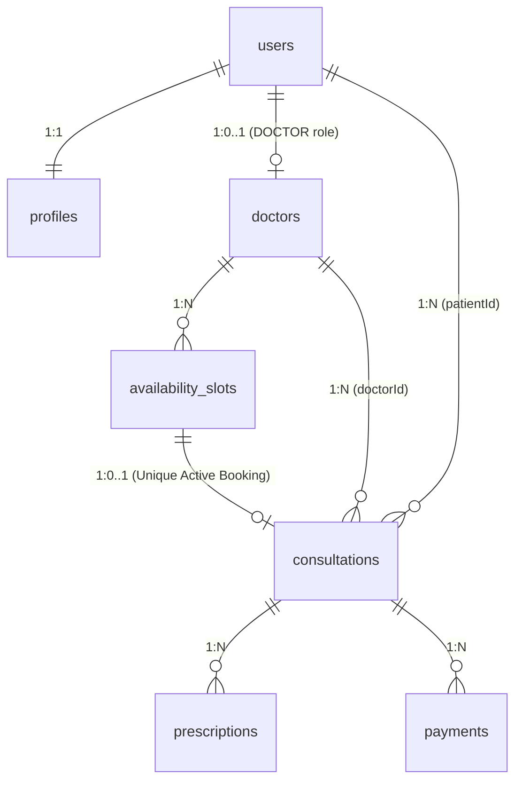
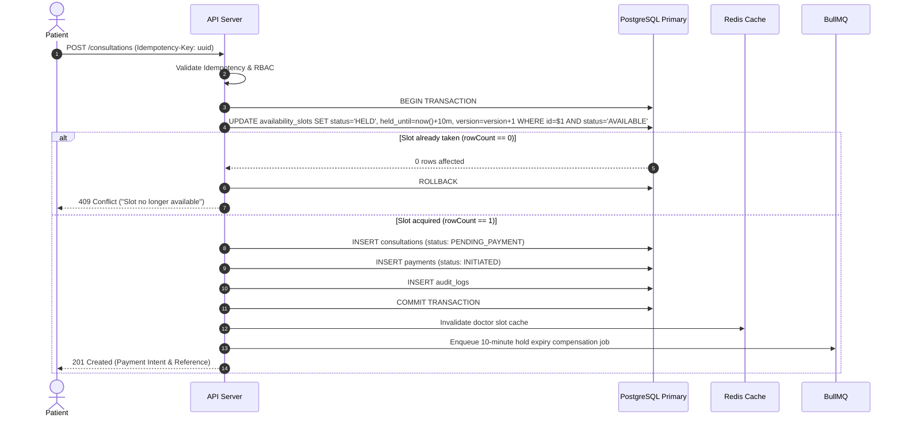

# Amrutam Telemedicine Backend: System Architecture Document

## 1. Executive Summary & Architectural Philosophy

The **Amrutam Telemedicine Backend** is engineered to provide an enterprise-grade, highly available, secure, and horizontally scalable healthcare platform capable of handling **100,000 daily consultations** with sub-200ms read latency (p95) and sub-500ms write latency (p95).

### Why a Modular Monolith?
For high developer velocity, transactional integrity, and operational simplicity, the system is designed as a **Modular Monolith**. Rather than introducing distributed transaction complexities (distributed 2PC, network overhead, microservice deployment sprawl), business domains are organized into strictly bounded modules:
- Auth & Identity
- Users & Profiles
- Doctors & Search
- Availability & Slots
- Consultations & State Machine
- Prescriptions & Encrypted Health Records (PHI)
- Payments & Webhooks
- Compliance & Audit Trail
- Admin & Analytics

Each module maintains strict internal isolation and communicates through explicit dependency injection. This enables seamless future extraction into isolated microservices without refactoring domain logic.

```
                    ┌──────────────┐
   Client ───────►  │ Nginx / LB   │  (TLS termination, edge rate limit)
                    └──────┬───────┘
                           ▼
              ┌────────────────────────┐
              │  Express API (N pods)  │  stateless, horizontally scalable (HPA 3-20)
              │  routes → controllers  │
              │  → services → repos    │
              └───┬──────────┬─────────┘
                  │          │
        ┌─────────▼──┐   ┌───▼──────────────┐
        │ PostgreSQL │   │ Redis 7          │
        │ primary    │   │ cache-aside,     │
        │ + replica  │   │ rate-limit,      │
        └─────▲──────┘   │ idempotency keys │
              │          │ BullMQ queues    │
        ┌─────┴──────┐   └───┬──────────────┘
        │ Worker     │◄──────┘
        │ (BullMQ)   │  slot expiry saga, notifications, analytics rollup
        └────────────┘
```

---

## 2. Layering & Clean Architecture Rules

To ensure high maintainability and testability, a strict unidirectionally coupled layering rule is enforced across all modules:

$$\text{Route} \longrightarrow \text{Middleware} \longrightarrow \text{Controller} \longrightarrow \text{Service} \longrightarrow \text{Repository}$$

- **Route**: Declares HTTP paths, HTTP methods, and attaches middleware pipelines.
- **Middleware**: Executes cross-cutting concerns (Request ID tracing, JWT authentication, RBAC authorization, Zod schema validation, Rate limiting, and Idempotency deduplication).
- **Controller (HTTP Only)**: Unpacks HTTP request parameters/body, invokes domain service, and formats JSON responses with appropriate HTTP status codes. No SQL or business rules reside in controllers.
- **Service (Business Logic & Transactions)**: Orchestrates domain rules, ACID transactions, cryptographic operations, cache invalidations, and saga events.
- **Repository (SQL Only)**: Isolates pure database queries using parameterized SQL statements (`pg` client). Zero business logic.

All layers are bound together via a lightweight Dependency Injection container (`src/container.js`).

---

## 3. Data Model & Relational Topology

### Core Tables (8)
1. **`users`**: Identity, credentials, role (`PATIENT`, `DOCTOR`, `ADMIN`), MFA metadata, account lockout counters.
2. **`profiles`**: Demographics and AES-256-GCM encrypted Protected Health Information (PHI) such as medical history and home address.
3. **`doctors`**: Doctor credentials, medical license number, verified status, consultation fee, experience, and average ratings.
4. **`availability_slots`**: 30-minute availability slots with optimistic locking `version` and status (`AVAILABLE`, `HELD`, `BOOKED`, `CANCELLED`).
5. **`consultations`**: Central booking entity linking patient, doctor, and slot, with status transition state machine.
6. **`prescriptions`**: Medical prescriptions issued by doctors, storing AES-256-GCM encrypted medicines and clinical instructions.
7. **`payments`**: Payment transaction logs, gateway references (`provider_ref`), and status.
8. **`audit_logs`**: Immutable, append-only compliance audit trail recording all state mutations and PHI access events.

### Support Tables (3)
1. **`refresh_tokens`**: Rotating refresh tokens supporting automatic session revocation upon reuse detection.
2. **`idempotency_keys`**: Request deduplication table caching status codes and response bodies for 24 hours.
3. **`specializations`**: Normalized Ayurvedic medical disciplines.

### Identity Clarification: Patients & Doctors
- **Patient ID**: A patient is represented directly by `users.id` where `role = 'PATIENT'`.
- **Doctor ID**: A doctor is represented by `doctors.id`, which holds a 1:1 foreign key `doctors.user_id → users.id`.
- `consultations.patient_id` references `users.id`.
- `consultations.doctor_id` references `doctors.id`.



---

## 4. The Booking Flow & Concurrency Defense

Double-booking prevention is the foundational integrity requirement of any telemedicine platform. Amrutam implements a **three-tier concurrency defense system**:



### Concurrency Layers:
1. **Atomic Conditional UPDATE (Primary Lock)**:
   ```sql
   UPDATE availability_slots
   SET status = 'HELD', held_until = NOW() + interval '10 minutes', version = version + 1
   WHERE id = $1 AND doctor_id = $2 AND status = 'AVAILABLE';
   ```
   Under PostgreSQL row-level locking, concurrent transactions targeting the same slot serialize on the row lock. The first transaction updates the status to `'HELD'`. All subsequent transactions find `status = 'AVAILABLE'` to be false and return `rowCount = 0`, immediately raising a `409 Conflict` without data corruption.
2. **Partial Unique Index (Database Safety Net)**:
   ```sql
   CREATE UNIQUE INDEX uq_consultation_active_slot 
   ON consultations (slot_id) 
   WHERE status IN ('PENDING_PAYMENT', 'CONFIRMED', 'IN_PROGRESS', 'COMPLETED');
   ```
   Even if an application error bypassed the slot check, the database engine physically rejects duplicate active bookings.
3. **Idempotency Lock**:
   A unique constraint on `idempotency_keys.key` ensures duplicate retries from unstable networks replay the original response rather than creating multiple bookings.

---

## 5. Distributed Sagas & Compensation Workflow

The booking process follows a **Local Saga Choreography** pattern:
1. **Hold Phase**: When a patient initiates a booking, the slot is held for 10 minutes (`held_until = NOW() + interval '10 minutes'`), and a consultation is created in `PENDING_PAYMENT` status.
2. **Scheduled Compensation**: A BullMQ delayed job (`expire-slot`) is scheduled with a 600,000ms (10 min) delay:
   ```javascript
   await bookingQueue.add('expire-slot', { consultationId, slotId }, { delay: 600000 });
   ```
3. **Saga Completion (Payment Success)**:
   The payment webhook receives `payment.success` with HMAC signature verification. In a single transaction:
   - `payments.status → SUCCESS`
   - `consultations.status → CONFIRMED`
   - `availability_slots.status → BOOKED`
   - Async notification dispatched to patient and doctor.
4. **Saga Compensation (Payment Timeout / Failure)**:
   When the delayed job executes at $T+10\text{ min}$:
   - Checks if consultation is still `PENDING_PAYMENT`.
   - If unpaid, marks consultation as `EXPIRED`.
   - Reverts `availability_slots.status → AVAILABLE` and clears `held_until`.
   - Invalidates Redis cache, freeing the slot for other patients.

---

## 6. Capacity Planning & Scale Calculations

### Traffic Projections
- **Target Volume**: 100,000 consultations per day.
- **Operating Window**: 14 peak hours per day (50,400 seconds).
- **Average Consultation Write Rate**:
  $$\text{Average Writes} = \frac{100,000}{86,400} \approx 1.16 \text{ writes/second}$$
- **Peak Write Rate (3x multiplier)**:
  $$\text{Peak Writes} = 1.16 \times 3 \approx 3.5 \text{ writes/second} \text{ (Burst: 15–20 writes/second)}$$
- **Read-to-Write Ratio**: Estimated at 10:1 (browsing doctors, checking slots, reading prescriptions).
- **Read Throughput**:
  $$\text{Peak Reads} = 20 \times 10 = 200 \text{ reads/second}$$

### Database Capacity Analysis
Modern PostgreSQL 16 on a 4 vCPU / 16 GB instance with SSD storage routinely sustains **3,000–5,000 writes/second**. With peak booking throughput at 20 writes/second, the primary database operates at under **2% of maximum write saturation**.

---

## 7. Data Partitioning Strategy

To maintain query performance over multiple years of operation, range partitioning is architected:
1. **`consultations` Table**: Partitioned monthly by `created_at`:
   ```sql
   CREATE TABLE consultations ( ... ) PARTITION BY RANGE (created_at);
   CREATE TABLE consultations_2026_01 PARTITION OF consultations
       FOR VALUES FROM ('2026-01-01') TO ('2026-02-01');
   ```
2. **`audit_logs` Table**: Partitioned monthly by `created_at`. Partitions older than 7 years are automatically moved to cold S3/GCS archival storage for compliance.

---

## 8. Caching & Performance Architecture

The platform uses a **Cache-Aside Pattern** with bounded Time-To-Live (TTL):
- **Doctor Search Results**: Cached in Redis for **60 seconds**, keyed by SHA-256 hash of the query parameters (`doctors:search:<hash>`).
- **Doctor Profiles**: Cached for **5 minutes**, invalidated immediately upon doctor profile update.
- **Available Slots**: Cached for **30 seconds** (`slots:<doctorId>`), invalidated immediately when a slot is held, booked, cancelled, or expired.

---

## 9. Resilience, Retries & Deadlock Mitigation

PostgreSQL transactions under high concurrency can encounter serialization anomalies (`40001`) or deadlock detection (`40P01`). The platform wraps all database transactions in an **Exponential Backoff with Full Jitter** retry handler (`src/utils/retry.js`):
$$T_{\text{wait}} = \text{random}(0, \min(T_{\text{max}}, T_{\text{initial}} \times 2^{\text{attempt}}))$$
Retries up to 3 times before returning an error to the client.

---

## 10. Observability & Telemetry

1. **Metrics (`prom-client`)**: Exposed at `/metrics`:
   - `http_request_duration_seconds`: Histogram tracking p50, p95, and p99 response times.
   - `bookings_total`: Counter tracking bookings by status.
   - `booking_conflicts_total`: Counter measuring blocked double-booking attempts.
   - `idempotency_replays_total`: Counter measuring requests served from idempotency cache.
2. **Structured Logging (`pino`)**:
   - JSON format with automatic redaction of sensitive PHI and credentials (`password`, `authorization`, `mfa_secret`, `notes_enc`).
   - Request-scoped tracing via `x-request-id`.
3. **Health Probes**:
   - `/health/live`: Container liveness.
   - `/health/ready`: Checks PostgreSQL pool connectivity and Redis availability.
